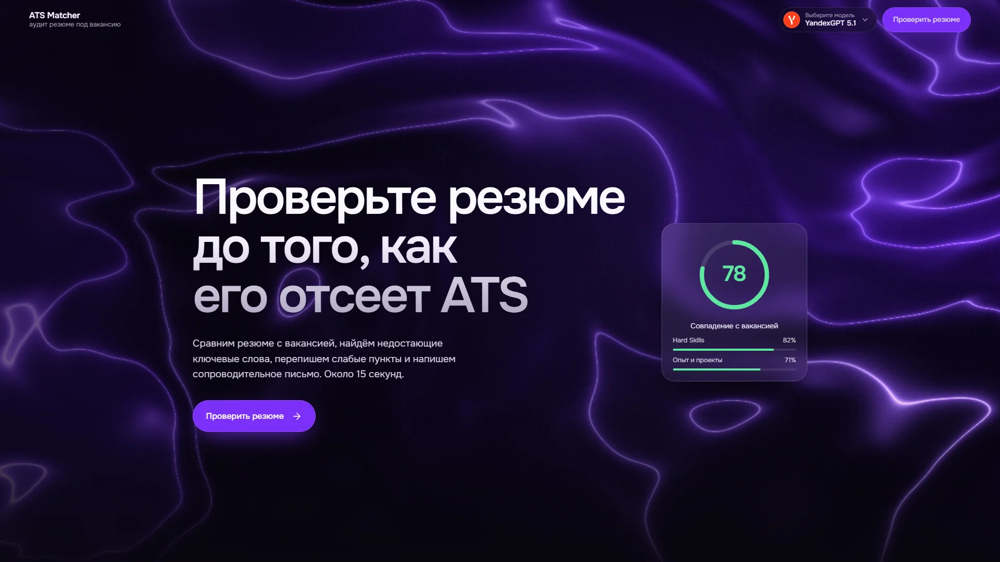
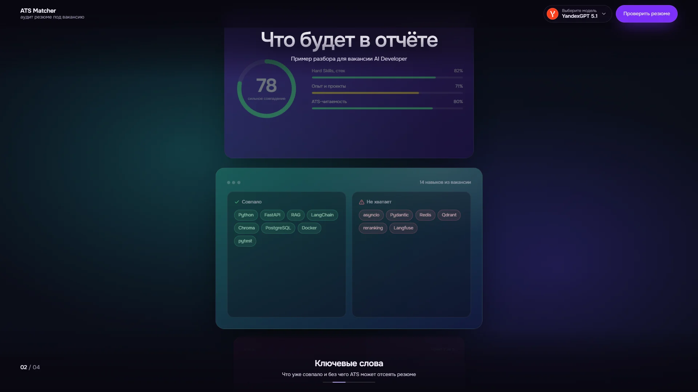
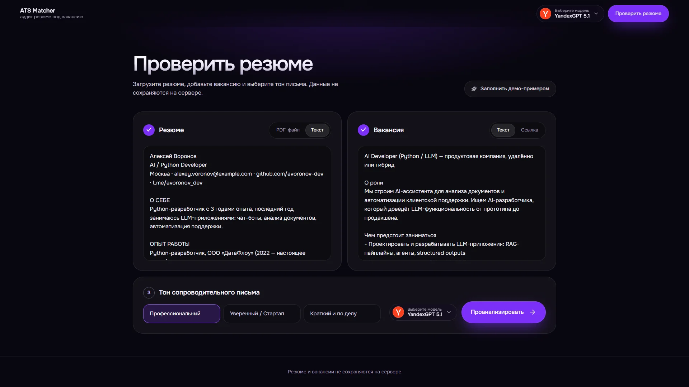
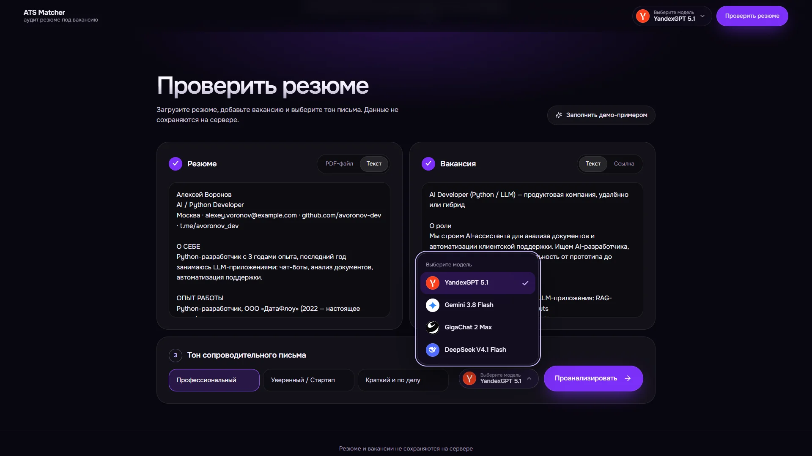
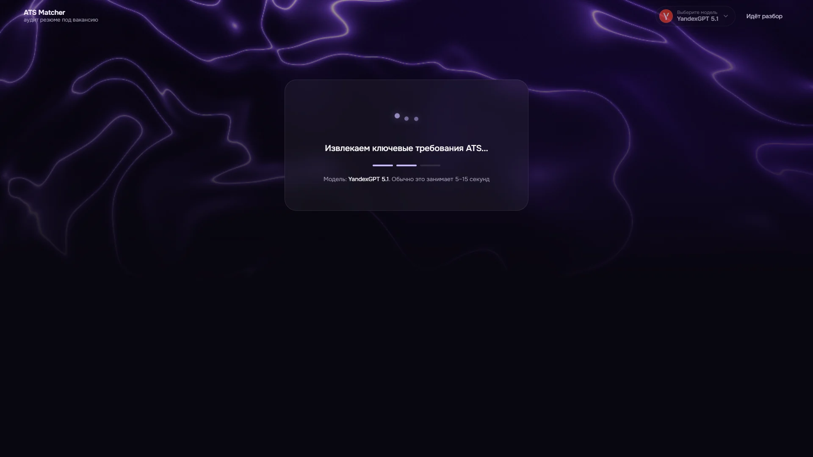
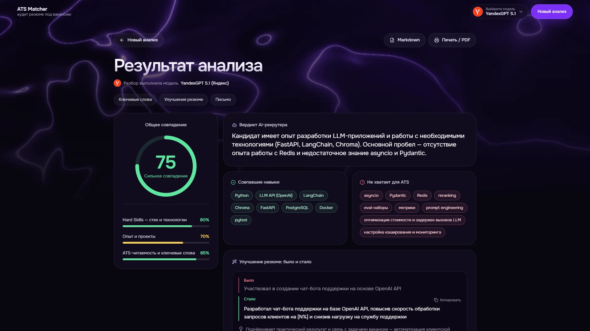
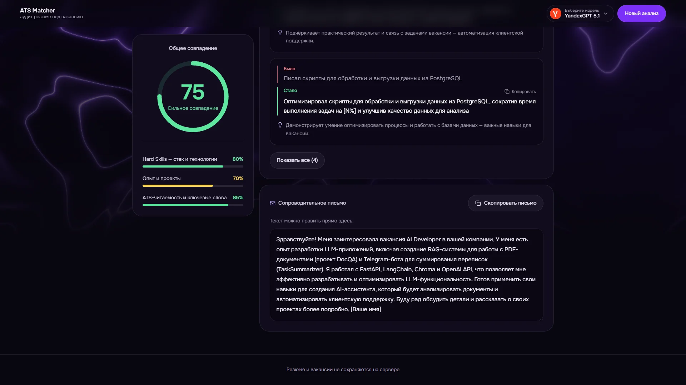
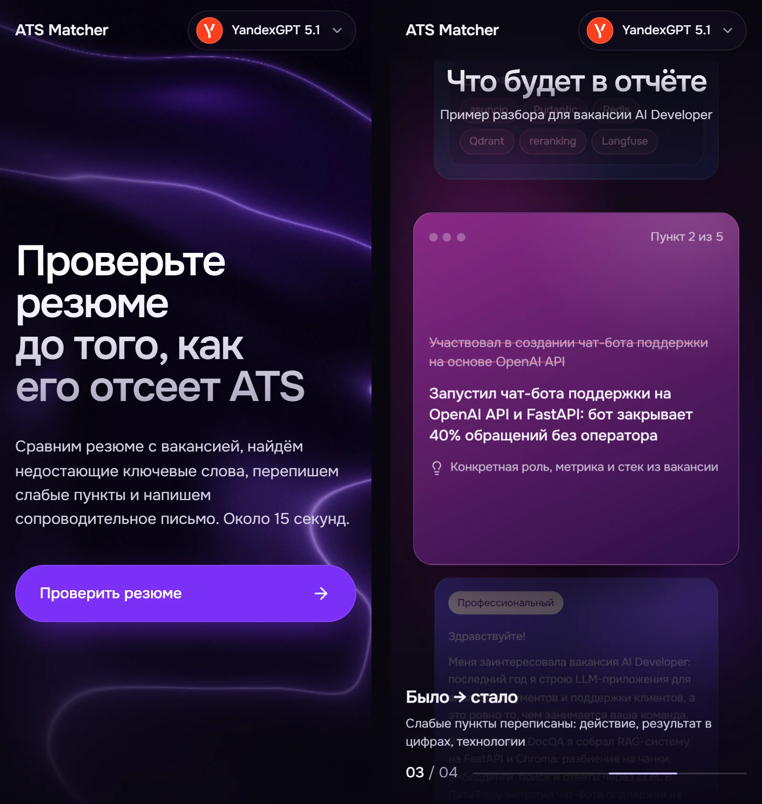

# AI Resume & ATS Matcher

Умный аудитор резюме и генератор сопроводительных писем на базе LLM: **YandexGPT 5.1** (по умолчанию), **Google Gemini**, **GigaChat** (Сбер) и **DeepSeek V4.1 Flash** (по выбору) с автоматическим переключением при сбоях.
Загрузите резюме (PDF или текст) и вакансию (текст или ссылку). Сервис проведёт ATS-аудит, найдёт пробелы по ключевым словам, перепишет слабые пункты резюме и напишет сопроводительное письмо под конкретную вакансию.

**Живой сайт:** https://ai-resume-matcher-ghdt.onrender.com

> Сайт работает на бесплатном хостинге Render. Если он долго не открывался, первая загрузка займёт 30–60 секунд.

## Скриншоты



Фон главного экрана живой: светящиеся складки «шёлка» плавно перетекают и реагируют на курсор.

| Что будет в отчёте | Проверка резюме |
|---|---|
|  |  |
| **Выбор модели** | **Анализ** |
|  |  |
| **Результат анализа** | **Сопроводительное письмо** |
|  |  |

**На телефоне**



## Возможности

- **ATS-оценка.** Общее совпадение в процентах и три шкалы: Hard Skills, опыт и проекты, ATS-читаемость.
- **Ключевые слова.** Совпавшие навыки (Matched Skills) и критичные пробелы, которые ATS может счесть за отказ (Missing Keywords).
- **Было → Стало.** Переписанные пункты резюме по методу XYZ (достижение + метрика + технологии) с кнопкой копирования.
- **Сопроводительное письмо.** Три тона на выбор. Язык письма совпадает с языком вакансии. Текст можно править прямо на странице.
- **Вакансия по ссылке.** Сервис сам скачивает страницу и извлекает текст. Есть защита от обращений к внутренним адресам.
- **Демо-режим.** Кнопка «Заполнить демо-примером» в форме проверки подставляет резюме и вакансию AI-разработчика, чтобы сразу увидеть работу сервиса.
- **Экспорт.** Отчёт в Markdown или печать / сохранение в PDF из браузера.
- **Выбор модели.** Пользователь сам выбирает, какая модель сделает разбор: YandexGPT 5.1, Gemini, GigaChat или DeepSeek. Список с логотипами есть в шапке и рядом с кнопкой «Проанализировать», работает мышью и с клавиатуры. Выбор запоминается в браузере.
- **Надёжность.** Цепочка по умолчанию: YandexGPT, затем Gemini, затем GigaChat. Если выбранная модель не отвечает, анализ автоматически выполняет следующая, и в отчёте это отмечено.
- **Прозрачность.** В отчёте указано, какая именно модель сделала разбор, и отмечено, если вместо выбранной ответила резервная.
- **Интерфейс.** Тёмная фиолетовая тема. На главном экране живой WebGL-фон, который реагирует на курсор. Блок «Что будет в отчёте» показывает четыре части отчёта: одно движение колеса перелистывает одну карточку. Вёрстка адаптирована под телефон, учитывается системная настройка «уменьшить движение».

## Стек

- **Backend:** Python 3.11+, FastAPI, uvicorn, Pydantic v2, pydantic-settings
- **LLM:** несколько провайдеров с автопереключением: YandexGPT 5.1 и DeepSeek V4.1 Flash (REST API Яндекса), Google Gemini (SDK `google-genai`, структурированный вывод через `response_schema`) и GigaChat (OAuth-токен с кешированием, сертификат НУЦ Минцифры). Для моделей без нативной JSON-схемы формат ответа задаётся примером в промпте, ответ проверяется Pydantic. Повторные запросы при сбоях и переход на запасного провайдера
- **Документы и веб:** PyMuPDF (чтение PDF), httpx и BeautifulSoup4 (загрузка и очистка страницы вакансии)
- **Frontend:** HTML, Tailwind CSS, Alpine.js, Lucide Icons, шрифт Onest. Живой фон главного экрана написан на WebGL без библиотек. Логотипы моделей: Яндекс, Gemini и DeepSeek из [lobe-icons](https://github.com/lobehub/lobe-icons) (MIT), GigaChat с официального сайта giga.chat. Без сборки Node.js
- **Тесты:** pytest, pytest-asyncio. LLM-провайдеры в тестах подменяются заглушками
- **Деплой:** Dockerfile, docker-compose

## Как это работает

```
Браузер (Alpine.js)
   │  POST /api/analyze  (PDF или текст резюме, текст или URL вакансии, тон)
   ▼
FastAPI  ──►  parser_service: PDF → текст (PyMuPDF), URL → текст (httpx + BeautifulSoup)
   │
   ▼
llm_service ──► основной провайдер ──► при сбое запасной (YandexGPT → Gemini → GigaChat)
   │
   ▼
Проверка ответа (диапазоны 0–100, минимум 3 пункта, один повтор при ошибке) → JSON → дашборд
```

Схема ответа описана в `app/schemas/analysis.py`. Gemini получает её напрямую через `response_schema`, YandexGPT, DeepSeek и GigaChat получают пример ответа в промпте. Ответ любого провайдера проверяется одной и той же Pydantic-моделью.

### Модели и их особенности

| Модель | Роль | Скорость | Как подключена |
|---|---|---|---|
| **YandexGPT 5.1** (Яндекс) | по умолчанию | 5–15 секунд | REST `foundationModels/v1/completion`, API-ключ сервисного аккаунта, `jsonObject` + пример в промпте |
| **Gemini 3.8 Flash** (Google) | первый резерв | 10–30 секунд | SDK `google-genai`, нативная JSON-схема (`response_schema`) |
| **GigaChat 2 Max** (Сбер) | второй резерв | 10–20 секунд | REST, OAuth-токен на 30 минут с кешированием, сертификат НУЦ Минцифры |
| **DeepSeek V4.1 Flash** | только по выбору | 40–90 секунд | тот же REST API и ключ Яндекса, в автоматическую цепочку не входит |

Как они ведут себя на практике:

- **YandexGPT 5.1** — основная модель. Отвечает быстрее всех, стабильно работает из России и даёт аккуратный разбор: понятные оценки, точные ключевые слова, грамотное письмо на русском.
- **Gemini** работает нестабильно. Сервис Google заблокирован в России, поэтому запросы с российских серверов часто не проходят, а API-ключи регулярно блокируются, и их приходится перевыпускать. Кроме того, бесплатный тариф бывает перегружен и отвечает ошибкой 429 или 503. Поэтому Gemini стоит в цепочке резервом, а не основной моделью.
- **GigaChat** работает из России без ограничений, но заметно уступает по качеству разбора. Оценки грубее, рекомендации общие, улучшенные пункты резюме чаще повторяют исходный текст, а не переписывают его с метриками. Используется как последний резерв, чтобы сервис ответил хоть чем-то.
- **DeepSeek V4.1 Flash** даёт самый подробный разбор, потому что сначала рассуждает, а потом отвечает. Зато отвечает в несколько раз дольше остальных, поэтому включается только вручную, когда важна глубина, а не скорость.

При ошибке 429, 5xx или таймауте запрос сразу переходит к следующей модели, чтобы пользователь не ждал повторов. Последняя модель в цепочке получает до двух попыток. Используются только модели, для которых задан ключ. Если ответила не та модель, которую выбрал пользователь, это отмечено в отчёте.

## Быстрый старт

Нужен хотя бы один ключ. Рекомендуется начать с YandexGPT ([Yandex AI Studio](https://aistudio.yandex.ru): API-ключ и идентификатор каталога). Резервные: Gemini ([Google AI Studio](https://aistudio.google.com/apikey), из России нужен доступ к сервисам Google) и GigaChat ([developers.sber.ru](https://developers.sber.ru/studio)). Модели без ключа не используются. При нескольких ключах порядок такой: YandexGPT, Gemini, GigaChat. DeepSeek V4.1 Flash работает на том же ключе Яндекса и доступен только при выборе вручную.

Для GigaChat нужен корневой сертификат НУЦ Минцифры: он уже лежит в `certs/russian_trusted_root_ca.pem` (подробности в `certs/README.md`).

```bash
python -m venv .venv
.venv\Scripts\activate            # macOS / Linux: source .venv/bin/activate
pip install -r requirements.txt
copy .env.example .env            # macOS / Linux: cp .env.example .env
```

В файле `.env` укажите ключ:

```env
LLM_PROVIDER=auto                    # auto, yandex, gemini или gigachat
YANDEX_API_KEY=ключ                  # основная модель (и DeepSeek по выбору)
YANDEX_FOLDER_ID=идентификатор_каталога
GEMINI_API_KEY=ваш_ключ              # необязательно, первый резерв
GEMINI_MODEL=gemini-3.8-flash
GIGACHAT_AUTH_KEY=ключ_авторизации   # необязательно, второй резерв
```

Запустите сервер:

```bash
uvicorn app.main:app --reload --port 8000
```

Откройте http://localhost:8000, нажмите «Проверить резюме», затем «Заполнить демо-примером» и «Проанализировать».

Проверить, что ключ подхвачен, можно по адресу http://localhost:8000/api/health: в ответе должно быть `"llm_configured": true`.

### Запуск через Docker

```bash
docker compose up --build
```

Сервис будет доступен на http://localhost:8000. Ключ берётся из того же файла `.env`.

## Тесты

```bash
pytest
```

Тесты не требуют ключей: LLM-провайдеры подменяются заглушками. Проверяются схемы, разбор PDF и HTML, защита от внутренних адресов, коды ошибок API, повторы и переключение провайдеров, кеширование токена GigaChat.

## API

| Метод и путь | Назначение |
|---|---|
| `POST /api/analyze` | Анализ резюме и вакансии |
| `GET /api/demo` | Демо-резюме и демо-вакансия |
| `GET /api/health` | Статус сервиса, модель и наличие ключа |

Параметры `POST /api/analyze` (`multipart/form-data`):

| Поле | Значение |
|---|---|
| `resume_file` или `resume_text` | PDF-файл до 10 МБ или текст резюме |
| `job_text` или `job_url` | Текст вакансии или ссылка на неё |
| `tone` | `Профессиональный`, `Уверенный / Стартап` или `Краткий и по делу` |

Ошибки возвращаются в виде `{"detail": "...", "code": "..."}`.

## Структура проекта

```
app/
├── main.py                 маршруты API и раздача страницы
├── config.py               настройки из .env
├── errors.py               ошибки с кодами для фронтенда
├── schemas/analysis.py     модели ответа и схема для LLM
├── services/
│   ├── llm_service.py      промпт ATS-аудитора, повторы и переключение провайдеров
│   ├── llm_providers.py    YandexGPT, DeepSeek, Gemini, GigaChat
│   └── parser_service.py   PDF, загрузка вакансии по ссылке
├── demo/demo_data.py       демо-резюме и демо-вакансия
├── templates/index.html    разметка страницы
└── static/
    ├── css/app.css         стили интерфейса
    ├── js/app.js           логика страницы, выбор модели, плавная прокрутка
    └── js/scene.js         живой фон главного экрана и прокрутка блока с примерами
certs/                      сертификат НУЦ Минцифры для GigaChat
tests/                      тесты
docs/                       скриншоты для README
```

## Приватность и ограничения

- Резюме и вакансии не сохраняются на сервере и не записываются в логи. Текст отправляется только в API выбранного LLM-провайдера.
- PDF без текстового слоя (скан) не распознаются: OCR не подключён. Вставьте текст вручную.
- Сайты, которые грузят вакансию через JavaScript или блокируют ботов (например, hh.ru и LinkedIn), могут не отдать текст по ссылке. В этом случае вставьте текст вакансии вручную.
- Ключи LLM-провайдеров хранятся только в `.env` (локально) и в переменных окружения хостинга, в репозиторий они не попадают.

## Автор

Проект сделан как портфолио AI-разработчика.
