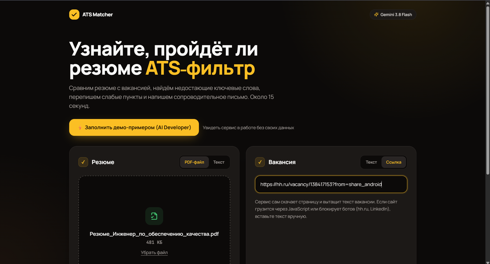
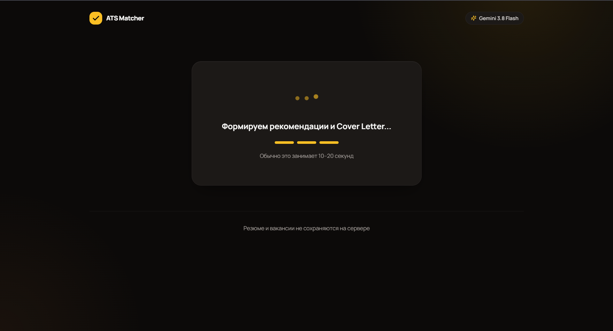
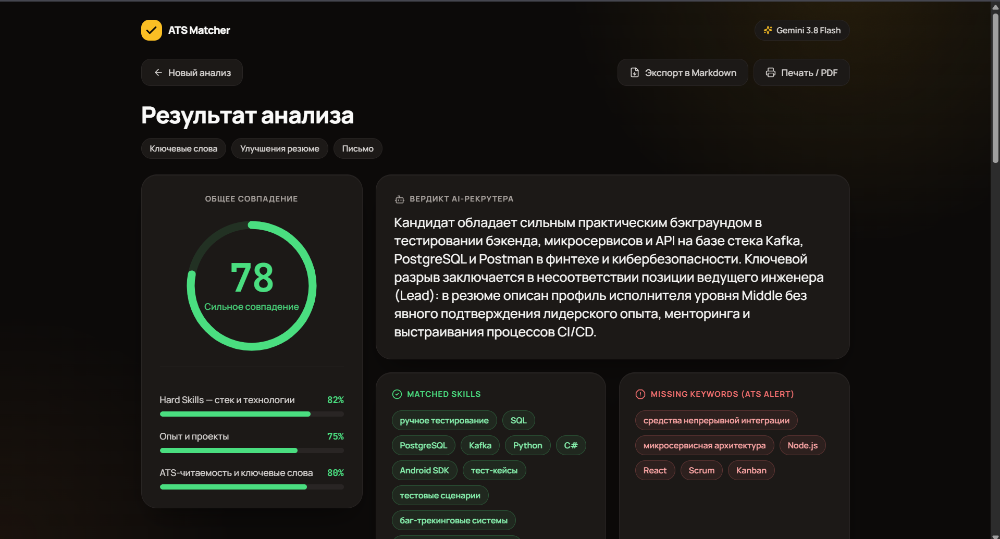
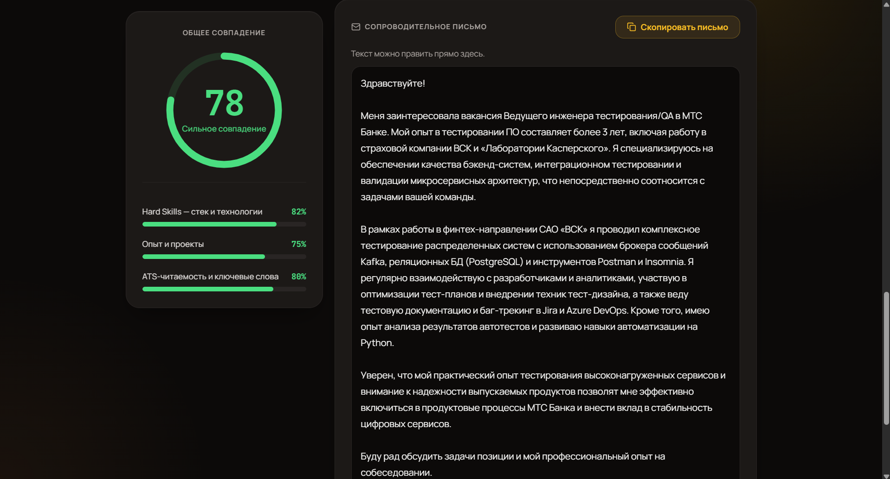

# AI Resume & ATS Matcher

Умный аудитор резюме и генератор сопроводительных писем на базе **Gemini**.
Загрузите резюме (PDF или текст) и вакансию (текст или ссылку). Сервис проведёт ATS-аудит, найдёт пробелы по ключевым словам, перепишет слабые пункты резюме и напишет сопроводительное письмо под конкретную вакансию.

## Скриншоты

| Экран ввода | Анализ |
|---|---|
|  |  |
| **Дашборд результатов** | **Сопроводительное письмо** |
|  |  |

## Возможности

- **ATS-оценка.** Общее совпадение в процентах и три шкалы: Hard Skills, опыт и проекты, ATS-читаемость.
- **Ключевые слова.** Совпавшие навыки (Matched Skills) и критичные пробелы, которые ATS может счесть за отказ (Missing Keywords).
- **Было → Стало.** Переписанные пункты резюме по методу XYZ (достижение + метрика + технологии) с кнопкой копирования.
- **Сопроводительное письмо.** Три тона на выбор. Язык письма совпадает с языком вакансии. Текст можно править прямо на странице.
- **Вакансия по ссылке.** Сервис сам скачивает страницу и извлекает текст. Есть защита от обращений к внутренним адресам.
- **Демо-режим.** Кнопка «Заполнить демо-примером» подставляет резюме и вакансию AI-разработчика, чтобы сразу увидеть работу сервиса.
- **Экспорт.** Отчёт в Markdown или печать / сохранение в PDF из браузера.

## Стек

- **Backend:** Python 3.11+, FastAPI, uvicorn, Pydantic v2, pydantic-settings
- **LLM:** официальный SDK `google-genai`, структурированный вывод через `response_schema`
- **Документы и веб:** PyMuPDF (чтение PDF), httpx и BeautifulSoup4 (загрузка и очистка страницы вакансии)
- **Frontend:** HTML, Tailwind CSS, Alpine.js, Lucide Icons. Без сборки Node.js
- **Тесты:** pytest, pytest-asyncio. Gemini в тестах подменяется заглушкой
- **Деплой:** Dockerfile, docker-compose

## Как это работает

```
Браузер (Alpine.js)
   │  POST /api/analyze  (PDF или текст резюме, текст или URL вакансии, тон)
   ▼
FastAPI  ──►  parser_service: PDF → текст (PyMuPDF), URL → текст (httpx + BeautifulSoup)
   │
   ▼
llm_service ──► Gemini (response_schema = AnalysisResult)
   │
   ▼
Проверка ответа (диапазоны 0–100, минимум 3 пункта, один повтор при ошибке) → JSON → дашборд
```

Схема ответа описана в `app/schemas/analysis.py`. Она же передаётся в Gemini, поэтому модель возвращает строго типизированный JSON.

## Быстрый старт

Нужен ключ Gemini API. Получить его можно в [Google AI Studio](https://aistudio.google.com/apikey).

```bash
python -m venv .venv
.venv\Scripts\activate            # macOS / Linux: source .venv/bin/activate
pip install -r requirements.txt
copy .env.example .env            # macOS / Linux: cp .env.example .env
```

В файле `.env` укажите ключ:

```env
GEMINI_API_KEY=ваш_ключ
GEMINI_MODEL=gemini-3.8-flash
```

Запустите сервер:

```bash
uvicorn app.main:app --reload --port 8000
```

Откройте http://localhost:8000 и нажмите «Заполнить демо-примером», затем «Проанализировать».

Проверить, что ключ подхвачен, можно по адресу http://localhost:8000/api/health: в ответе должно быть `"llm_configured": true`.

### Запуск через Docker

```bash
docker compose up --build
```

Сервис будет доступен на http://localhost:8000. Ключ берётся из того же файла `.env`.

## Тесты

```bash
pytest
```

Тесты не требуют ключа Gemini: модель подменяется в тестах. Проверяются схемы, разбор PDF и HTML, защита от внутренних адресов и коды ошибок API.

## API

| Метод и путь | Назначение |
|---|---|
| `POST /api/analyze` | Анализ резюме и вакансии |
| `GET /api/demo` | Демо-резюме и демо-вакансия |
| `GET /api/health` | Статус сервиса, модель и наличие ключа |

Параметры `POST /api/analyze` (`multipart/form-data`):

| Поле | Значение |
|---|---|
| `resume_file` или `resume_text` | PDF-файл до 10 МБ или текст резюме |
| `job_text` или `job_url` | Текст вакансии или ссылка на неё |
| `tone` | `Профессиональный`, `Уверенный / Стартап` или `Краткий и по делу` |

Ошибки возвращаются в виде `{"detail": "...", "code": "..."}`.

## Структура проекта

```
app/
├── main.py                 маршруты API и раздача страницы
├── config.py               настройки из .env
├── errors.py               ошибки с кодами для фронтенда
├── schemas/analysis.py     модели ответа и схема для Gemini
├── services/
│   ├── llm_service.py      промпт ATS-аудитора и вызов Gemini
│   └── parser_service.py   PDF, загрузка вакансии по ссылке
├── demo/demo_data.py       демо-резюме и демо-вакансия
├── templates/index.html    разметка страницы
└── static/                 стили и скрипт интерфейса
tests/                      тесты
docs/                       скриншоты для README
```

## Приватность и ограничения

- Резюме и вакансии не сохраняются на сервере и не записываются в логи. Текст отправляется только в Gemini API.
- PDF без текстового слоя (скан) не распознаются: OCR не подключён. Вставьте текст вручную.
- Сайты, которые грузят вакансию через JavaScript или блокируют ботов (например, hh.ru и LinkedIn), могут не отдать текст по ссылке. В этом случае вставьте текст вакансии вручную.
- Ключ Gemini хранится только в `.env`, который не попадает в репозиторий.

## Автор

Проект сделан как портфолио AI-разработчика.
